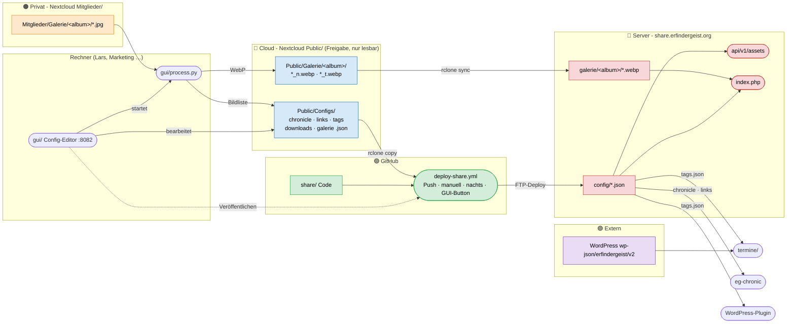
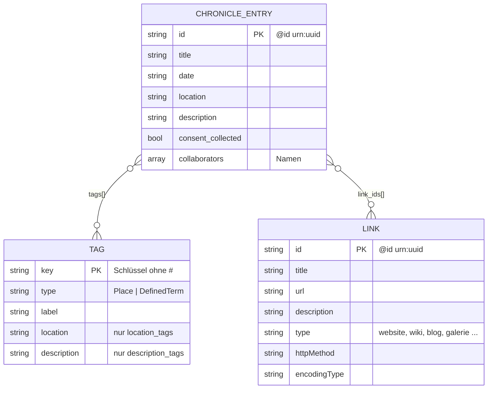
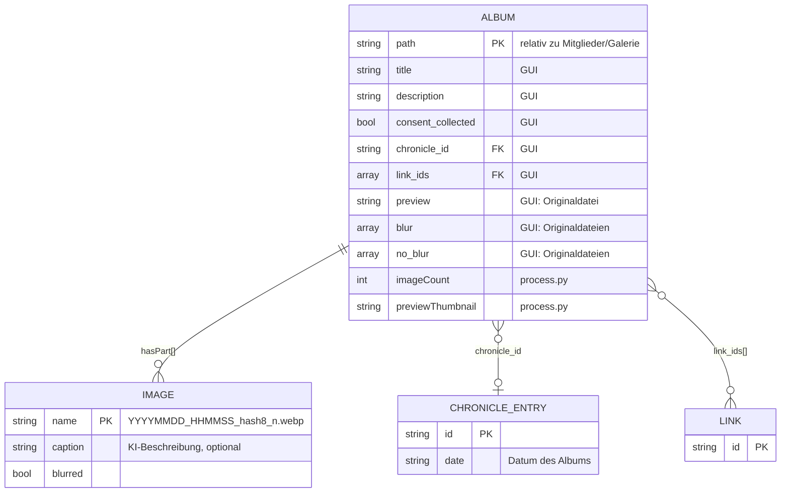
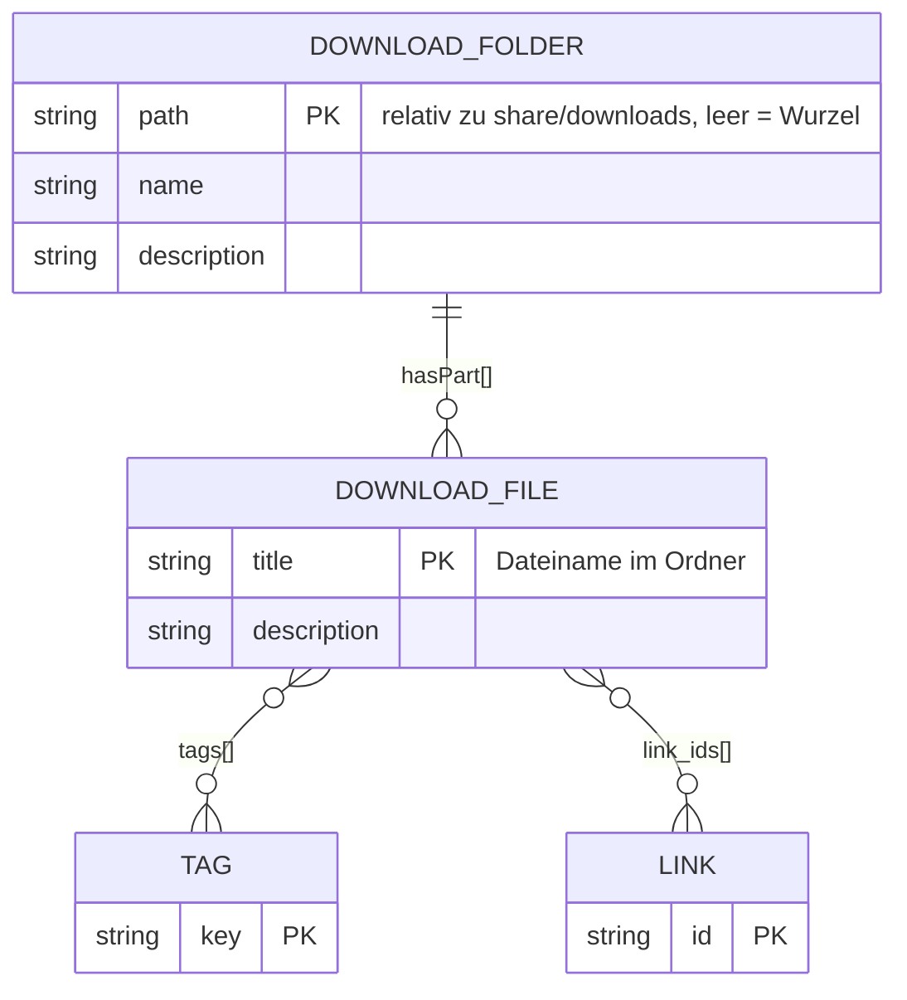
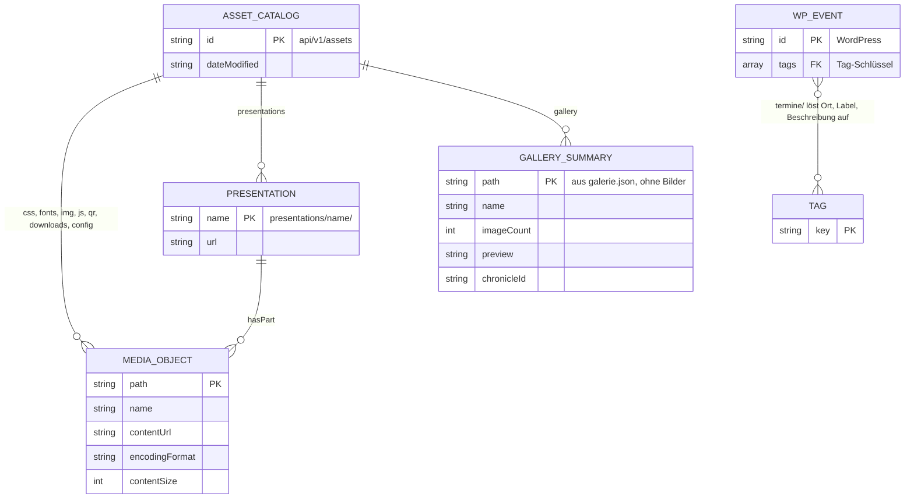
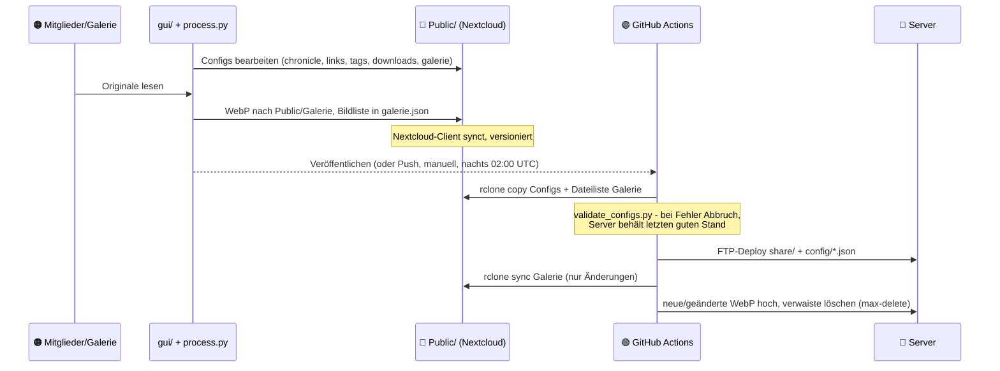

# Datenmodell - Erfindergeist Jülich

Alle JSON-Daten (Chronik, Links, Tags, Downloads, Galerie, API) mit **Speicherort**:
Wo liegt das Original, wer pflegt es, und wie kommt es auf den Server?

## Speicherort-Legende

| Kürzel | Ort | Bedeutung |
| --- | --- | --- |
| 🟢 **GitHub** | Repository `website` | Code (PHP, JS, CSS, Templates). Kein Inhalt mehr. |
| 🔵 **Cloud** | Nextcloud `Public/` (öffentliche Freigabe, nur lesbar) | **Quelle der Wahrheit** für alle Configs (`Public/Configs`) und die verpixelten Galerie-Bilder (`Public/Galerie`). Versioniert durch die Nextcloud. |
| 🟠 **Privat** | Nextcloud `Mitglieder/Galerie` | Originalfotos, nur für Mitglieder. Verlassen nie die Nextcloud. |
| 🔴 **Server** | Webspace `share.erfindergeist.org` | Deploy-Ziel und **einzige Quelle zur Laufzeit**: Share, termine, eg-chronic und WordPress lesen nur von hier, nie aus der Cloud. Wird von `deploy-share.yml` aus GitHub + Cloud befüllt, nie von Hand. |
| 🟣 **Extern** | WordPress `erfindergeist.org` | Termine. Wird nur gelesen. |

Lokale Pfade: `SOURCE_DIR` (in `gui/.env`) ist die Nextcloud-Wurzel, z.B. `/home/lars/erfindergeist`.

---

## Übersicht

### Dateitabelle

| Datei | Speicherort | Format | Gepflegt von | Gelesen von |
| --- | --- | --- | --- | --- |
| `Public/Configs/chronicle.json` | 🔵 Cloud → 🔴 `config/` | JSON-LD `ItemList > Event[]` | GUI Chronik-Tab | API, Share-Galerie, `eg-chronic` |
| `Public/Configs/links.json` | 🔵 Cloud → 🔴 `config/` | JSON-LD `ItemList > ListItem[]` | GUI Links-Tab | API, Share, `eg-chronic`, Linktree |
| `Public/Configs/tags.json` | 🔵 Cloud → 🔴 `config/` | JSON-LD `DefinedTermSet` | GUI Tags-Tab | API, `termine/`, WordPress-Plugin |
| `Public/Configs/downloads.json` | 🔵 Cloud → 🔴 `config/` | JSON-LD `DataCatalog` (Ordner → Dateien) | GUI Downloads-Tab | API, Downloads-Tab |
| `Public/Configs/galerie.json` | 🔵 Cloud → 🔴 `config/` | JSON-LD `DataCatalog` (Alben → Bilder), kompakt, ca. 280 KB | GUI Alben-Tab + `process.py` | API (`gallery`), `share.js` |
| `Public/Galerie/<album>/*.webp` | 🔵 Cloud → 🔴 `galerie/` | WebP (verpixelt) | `process.py` | Galerie-Tab |
| `Mitglieder/Galerie/<album>/*.jpg` | 🟠 Privat | Original | Fotograf:innen | `process.py`, GUI-Bildauswahl |
| `share/downloads/**/*.pdf …` | 🔴 Server (nur wenige SVGs in GitHub) | Binär | manuell per FTP | API (`downloads`) |
| `share/presentations/<name>/…` | 🔴 Server | HTML / PDF | manuell per FTP | API (`presentations`) |
| `GET /api/v1/assets` | 🔴 Server, zur Laufzeit erzeugt | JSON-LD `DataCatalog` | `share/api.php` | Homepage, externe Clients |
| `wp-json/erfindergeist/v2/events` | 🟣 Extern | JSON | WordPress | `termine/` |

---

## ER-Diagramme

Aufgeteilt nach Datei. Primärschlüssel sind die Werte, über die andere Dateien referenzieren.

### 1. Chronik, Links, Tags

### 2. Galerie (`galerie.json`)

Aus `IMAGE.name` abgeleitet, nicht gespeichert: `sourceHash` (3. Teil, Deep-Link `#gallery/<path>/<hash>`),
`dateCreated` (1. + 2. Teil), Thumbnail (`_n.webp` → `_t.webp`), URL (`galerie/<path>/<name>`).
Alben haben **keine Tags**. Datum und Tags kommen über `chronicle_id` aus der Chronik.

### 3. Downloads (`downloads.json`)

Die Dateien selbst liegen auf dem 🔴 Server. `api.php` ergänzt Größe, MIME-Typ und URL (`MediaObject`).

### 4. API und externe Daten

### Wo Tags genutzt werden

| Nutzer | Wie |
| --- | --- |
| `termine/js/main.js` (termine.erfindergeist.org) | lädt `config/tags.json`, löst Tags der WordPress-Termine zu Ort, Label und Beschreibung auf |
| WordPress-Plugin (nicht in diesem Repo) | liest `config/tags.json` |
| Chronik-Einträge `tags[]` | Filter in der GUI, Anzeige auf share |
| Download-Dateien `tags[]` | Filter im Downloads-Tab |

---

## Deploy-Ablauf

---

## API-Zugriff (Share)

`GET https://share.erfindergeist.org/api/v1/assets` - wird bei jedem Aufruf aus dem Dateisystem des Servers erzeugt.

| Abschnitt | Quelle | Ursprung |
| --- | --- | --- |
| `assets.css`, `fonts`, `img`, `js`, `qr` | Dateiscan | 🟢 GitHub |
| `assets.config.files` | alle `config/*.json` | 🔵 Cloud |
| `assets.config.content` | Inhalt von `chronicle`, `links`, `tags` | 🔵 Cloud |
| `assets.downloads` | Dateiscan + `downloads.json` | Dateien 🔴 Server, Metadaten 🔵 Cloud |
| `assets.presentations` | Unterordner von `presentations/` | 🔴 Server |
| `assets.gallery` | Album-Zusammenfassungen aus `galerie.json` | 🔵 Cloud |

Die vollständigen Bildlisten lädt die Share-Seite einmalig aus `config/galerie.json`.

---

## GUI-API (lokaler Config-Editor, Port 8082)

| Methode | Pfad | Entitäten | Schreibt nach |
| --- | --- | --- | --- |
| `GET /api/all` | Chronik, Links, Tags | `CHRONICLE_ENTRY`, `TAG`, `LINK` | - |
| `POST /api/save/chronicle` | Chronik schreiben | `CHRONICLE_ENTRY` | 🔵 `chronicle.json` |
| `POST /api/save/links` | Links schreiben | `LINK` | 🔵 `links.json` |
| `POST /api/save/tags` | Tags schreiben | `TAG` | 🔵 `tags.json` |
| `GET /api/albums` | Album-Liste | `ALBUM` | - |
| `GET /api/album/dirs` | Ordner in `Mitglieder/Galerie` ohne Album | - | - |
| `GET /api/album?path=` | Config-Felder eines Albums | `ALBUM` | - |
| `POST /api/album?path=` | Album anlegen/ändern (409 während Bildverarbeitung) | `ALBUM` | 🔵 `galerie.json` |
| `POST /api/album/delete?path=` | Album entfernen (409 während Bildverarbeitung) | `ALBUM` | 🔵 `galerie.json` |
| `GET /api/album/images?path=` | Originaldateien eines Albums | - | - |
| `GET /api/album/image?path=&file=` | Original / Vorschau ausliefern | - | - |
| `GET /api/downloads` | Ordnerliste | `DOWNLOAD_FOLDER` | - |
| `GET /api/download-entries` | alle Datei-Einträge | `DOWNLOAD_FILE` | - |
| `GET/POST /api/download-meta?path=` | Ordner-Eintrag lesen/schreiben | `DOWNLOAD_FOLDER`, `DOWNLOAD_FILE` | 🔵 `downloads.json` |
| `GET /api/download-files?path=` | lokal vorhandene Dateien | - | - |
| `POST /api/galerie/run`, `/cancel`, `GET /status`, `/stream` | `process.py` steuern | `ALBUM`, `IMAGE` | 🔵 `Public/Galerie`, `galerie.json` |
| `POST /api/publish` | startet `deploy-share.yml` (GitHub-API, `GITHUB_TOKEN`) | - | - |
